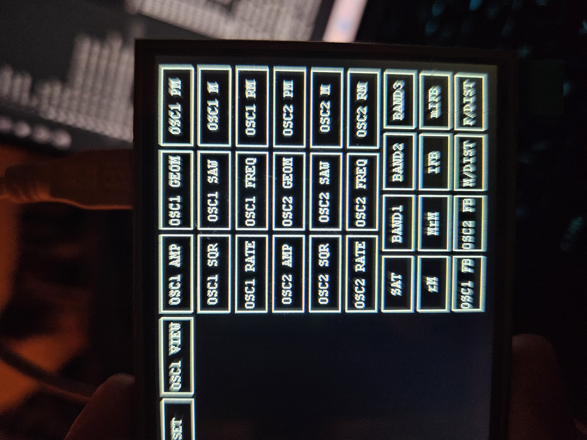

# Artificial Life MIDI Controller

Touchscreen MIDI controller for [Artificial Life](https://andreijaycreativecoding.com/ARTIFICIAL_LIFE), based on a Raspberry Pi Pico (RPi Pico) and a [3.5-inch LCD Touchscreen](https://www.berrybase.de/en/3.5-inch-touch-display-module-for-raspberry-pi-pico-65k-colours-480-320-spi).

Provides MIDI control over all functions and parameters of Artificial Life.

## Guide

### OSC1 / OSC2 Buttons

Each button creates a slider that sends MIDI values (0–127) on the selected CC channel, with parameter mapping as specified in the Artificial Life manual.

Default values are set to the standard defaults. MIDI latching is implemented, so it is recommended to move the slider slowly at first to ensure that the value change is registered correctly.

An **Audio** button creates a second slider that reads the ADC input and adds its value to the main CC value.

The second slider controls the scaling of the ADC input:

- At the maximum slider position, 3.3V corresponds to a MIDI value of 127.
- An optional **Inv** button inverts the effect, causing the scaled ADC value to be subtracted from the main slider value instead.

### Colour Buttons

These buttons generate two sliders:

- **Left slider:** Controls OSC1.
- **Right slider:** Controls OSC2.

Apart from controlling both oscillators independently, these sliders function in the same way as the other sliders.

### Reset

The **Reset** button resets all sliders to their default values and attempts to toggle off the following buttons:

- Sqr
- Saw
- OSC1/2m

Occasionally, these buttons do not reset correctly due to MIDI latching issues. If this happens, toggling the affected buttons on and off should resolve the issue.

This behaviour is still to be debugged.
